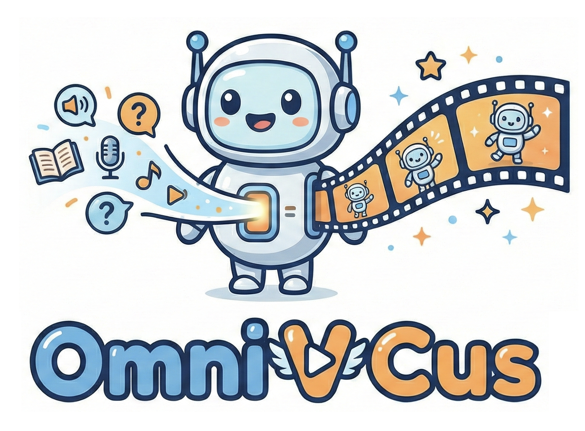
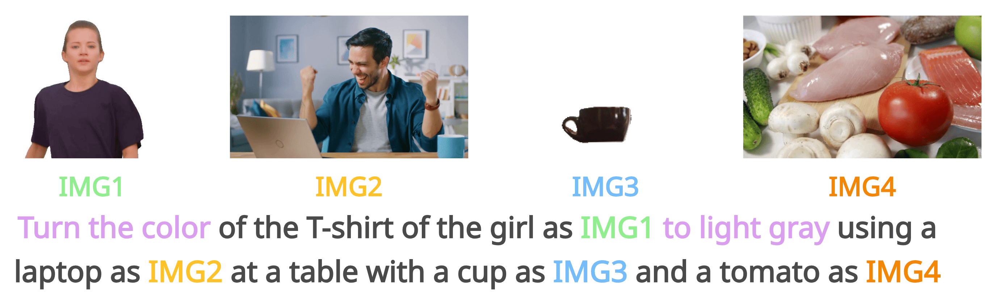
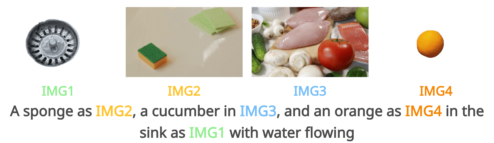
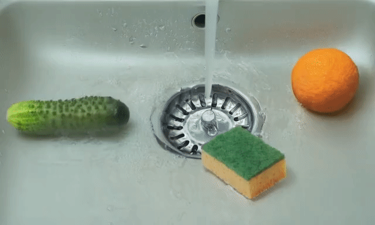

&nbsp;

<div align="center">

<p align="center">  </p>

[](https://arxiv.org/abs/2506.23361)&nbsp;
[](https://caiyuanhao1998.github.io/project/OmniVCus/)&nbsp;
[](https://zhuanlan.zhihu.com/p/1988577914237785212)&nbsp;
[](https://huggingface.co/datasets/CaiYuanhao/OmniVCus-Train)&nbsp;
[](https://huggingface.co/datasets/CaiYuanhao/OmniVCus-Test)&nbsp;
[](https://huggingface.co/CaiYuanhao/OmniVCus)&nbsp;
[](https://huggingface.co/spaces/CaiYuanhao/OmniVCus)&nbsp;

<h4>[NeurIPS 2025] OmniVCus: Feedforward Subject-driven Video Customization with Multimodal Control Conditions</h4> 

<p style="font-size: 20px;">
  Applied in the post-training of
  
  <strong>Adobe Firefly Video Foundation Model</strong>
</p>

<p align="center">
  
  
  
  
</p>


&nbsp;

</div>


### Introduction
This part of code implements the video depth control condition construction. If you find our repo useful, please give it a star ⭐ and consider citing our paper. Thank you :)


### 1. Installing Environment

```bash
conda activate videocus_factory
pip install -r requirements.txt
```

### 2. Downloading Model

Download the checkpoints listed [here](#pre-trained-models) and put them under the `checkpoints` directory.

```sh
bash get_weights.sh
```

### 3. Processing Data
We write a dara parallel version for your convinience to process the data using 8 nodes with 8 GPUs per node as

```sh
. process_data_depth.sh --part_id 0
. process_data_depth.sh --part_id 1
. process_data_depth.sh --part_id 2
. process_data_depth.sh --part_id 3
. process_data_depth.sh --part_id 4
. process_data_depth.sh --part_id 5
. process_data_depth.sh --part_id 6
. process_data_depth.sh --part_id 7
```

### 4. Citation

If you find this project useful, please consider citing our paper:

```sh
@inproceedings{omnivcus,
  title={OmniVCus: Feedforward Subject-driven Video Customization with Multimodal Control Conditions},
  author={Yuanhao Cai and He Zhang and Xi Chen and Jinbo Xing and Kai Zhang and Yiwei Hu and Yuqian Zhou and Zhifei Zhang and Soo Ye Kim and Tianyu Wang and Yulun Zhang and Xiaokang Yang and Zhe Lin and Alan Yuille},
  booktitle={NeurIPS},
  year={2025}
}
```
